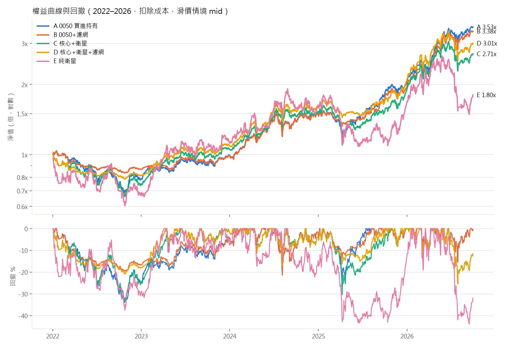

# 台股大盤濾網 + 0050 核心 + 月營收動能衛星：回測與前瞻驗證

用嚴格的「開發期 → 樣本外 → 前瞻」流程，檢驗一個台股資產配置策略是否真的有效。
判準在看結果之前就寫死並以 SHA256 鎖定，避免事後調參數、挑結果。

## 結論

| 階段 | 期間 | 對象 | 結果 |
|---|---|---|---|
| 開發期 | 2015-01 ~ 2021-12 | D（核心＋衛星＋濾網）對 A（0050 買進持有） | 通過 |
| 樣本外 | 2022-01 ~ 2026-09 | 同上，判準不變 | **不通過**（Sharpe 1.242 對 1.282） |
| 前瞻 | 2026-11-02 ~ 2029-10-31 | B（0050＋濾網）對 A | 進行中，判定日 2029-10-31 |

- **策略 D 不成立**：衛星選股在開發期貢獻報酬，到了樣本外反而拖累，賺得比它取代的 0050 少。
- **大盤濾網值得繼續觀察**：B 在兩段期間的回撤都明顯小於 A（樣本外 −21.3% 對 −33.9%），但 B 是看過結果後才提出的假設，所以另外登記為前瞻驗證，只用 2026-11 之後的新資料判定。

完整數字見 [`reports/oos_2022_2026/oos_2022_2026.md`](reports/oos_2022_2026/oos_2022_2026.md)，決策過程見 [`docs/decisions.md`](docs/decisions.md)。



## 策略規則

| 元件 | 規則 |
|---|---|
| 大盤濾網 | 加權指數收盤 > 200 日均線 → 總曝險 100%，否則 30% |
| 核心 | 0050，占曝險的 60% |
| 衛星 | 占曝險的 40%，最多 8 檔等權，同產業最多 3 檔 |
| 進場條件 | 近 3 月營收年增率平均 > 近 12 月平均、收盤 > 60 日線、120 日報酬前 20%、20 日均成交金額 ≥ 5,000 萬 |
| 續抱緩衝 | 強度仍在前 40%，且仍站上 60 日線、成交金額達標 |
| 出場 | 每週檢查是否跌破 60 日線；每月營收公布後重新選股 |
| 執行 | 收盤產生訊號、次日開盤成交；開盤漲停買不到、跌停賣不掉順延；整數股 |
| 成本 | 手續費 0.1425%（最低 20 元）、證交稅股票 0.3% / ETF 0.1%、滑價 0.1% / 0.3% / 0.5% 三種情境 |

五個對照組：A（0050）、B（0050＋濾網）、C（核心＋衛星）、D（核心＋衛星＋濾網）、E（純衛星），用 2×2 歸因拆開濾網與選股各自的貢獻。

## 資料處理重點

- **營收不偷看未來**：每月營收一律視為次月 11 日（遇假日順延）才可用，每次執行都斷言「用到的營收公布日 ≤ 訊號日」
- **含下市股**：股票池包含後來下市的公司，並量化下市股缺營收造成的存活者偏差
- **自行還原股價**：以除權息參考價、分割與面額變更計算還原因子；成交與漲跌停一律用原始價
- **排除興櫃期間 K 線**：資料源會混入上市前的興櫃價格，以跳動單位與 OHLC 一致性偵測真正上市日，並對證交所官方上市日期驗證
- **官方公司行為校正**：以證交所／櫃買中心的減資與除權息紀錄補足資料源缺漏

細節與限制見 [`docs/data_audit.md`](docs/data_audit.md)、[`docs/flag_review.md`](docs/flag_review.md)。

## 防止事後調整的機制

| 機制 | 位置 |
|---|---|
| 開發期 config 鎖定雜湊 | `logs/config_lock.json`、`logs/config_dev_locked.yaml` |
| 樣本外必須明確解鎖，並記錄每次執行 | `config.yaml` 的 `oos_unlocked`、`logs/oos_unlock_log.jsonl` |
| 樣本外 config 只能比開發期多改起訖日與解鎖開關 | `logs/config_lock_oos.json` |
| 前瞻假設在前瞻期開始前鎖定，之後修改會被拒絕 | `forward_B.yaml`、`logs/forward_B_lock.json` |

鎖定檔以 `.gitattributes` 設為不轉換換行，確保 clone 後雜湊不變。

## 專案結構

```
config.yaml            策略參數（已鎖定）
forward_B.yaml         B 的前瞻驗證預先登記（已鎖定）
src/twbt/              回測套件：資料、訊號、引擎、成本、指標、報告、前瞻、通知
scripts/               下載、回測、前瞻驗證、每日訊號
tests/                 pytest（前視偏誤、假日順延、成本、下市、鎖定、通知）
docs/                  資料稽核、減資標記核對、決策紀錄
reports/               開發期（v1 原始、v2 修正）與樣本外報告、圖表、交易明細
logs/                  鎖定與解鎖紀錄
```

## 使用方式

### 安裝

需要 Python 3.11 以上與 [FinMind](https://finmindtrade.com/) 帳號（Free 等級即可）。

```bash
pip install -r requirements.txt
```

FinMind token 從環境變數 `FINMIND_TOKEN` 讀取，不寫在任何檔案裡。

### 重現回測

`data/` 不在版本控制內（約 250 MB），需要先下載。Free 等級每小時 600 次請求，完整下載約需 10 小時，中斷後重跑會從斷點接續。

```bash
python scripts/download_all.py
```

```bash
python scripts/fetch_official_actions.py
```

```bash
python scripts/run_dev.py --variant v2_corrected
```

樣本外資料與回測：

```bash
python scripts/download_oos.py
```

```bash
python scripts/fetch_official_actions.py 2022 2026
```

```bash
python scripts/run_oos.py
```

### 前瞻驗證（每月一次）

只需要大盤與 0050 資料，每次約 6 次 API 請求。判定日前只會顯示「進度」。

```bash
python scripts/download_forward.py
```

```bash
python scripts/run_forward.py
```

結果在 `reports/forward_B/status.md`，歷次紀錄累積在 `history.csv`。

### 每日資產配置訊號（Telegram）

依 B 的規則判斷明天 0050 該持有 100% 或 30%，只在以下情況通知：大盤穿越 200 日線（需要調整部位）、每週五簡報、0050 除息日、資料異常。

```bash
python scripts/daily_signal.py --dry-run --kind weekly
```

Telegram bot 設定從 `.env` 讀取 `TELEGRAM_BOT_TOKEN`、`TELEGRAM_CHAT_ID`，路徑由環境變數 `MAILER_ENV` 指定。Windows 可用 `run_daily_signal.cmd` 搭配工作排程器，平日收盤後執行。

### 測試

```bash
python -m pytest -q
```

## 已知限制

- 下市股的月營收大量缺漏，存在存活者偏差（已量化，見各報告第 5 節）
- 資料源無法辨識全額交割股，未排除
- 產業分類只有當前版本，沒有歷史分類
- 營收無法區分首次公告值與更正值
- 下市股假設在最後交易日收盤出場，實際上資金可能被卡住更久
- 前瞻期約 750 個交易日，Sharpe 差距的統計雜訊仍大；通過也只是增加信心，不是證明

## 免責聲明

本專案僅供研究與教育用途，不構成任何投資建議。回測結果不代表未來績效，實際交易請自行評估風險。
