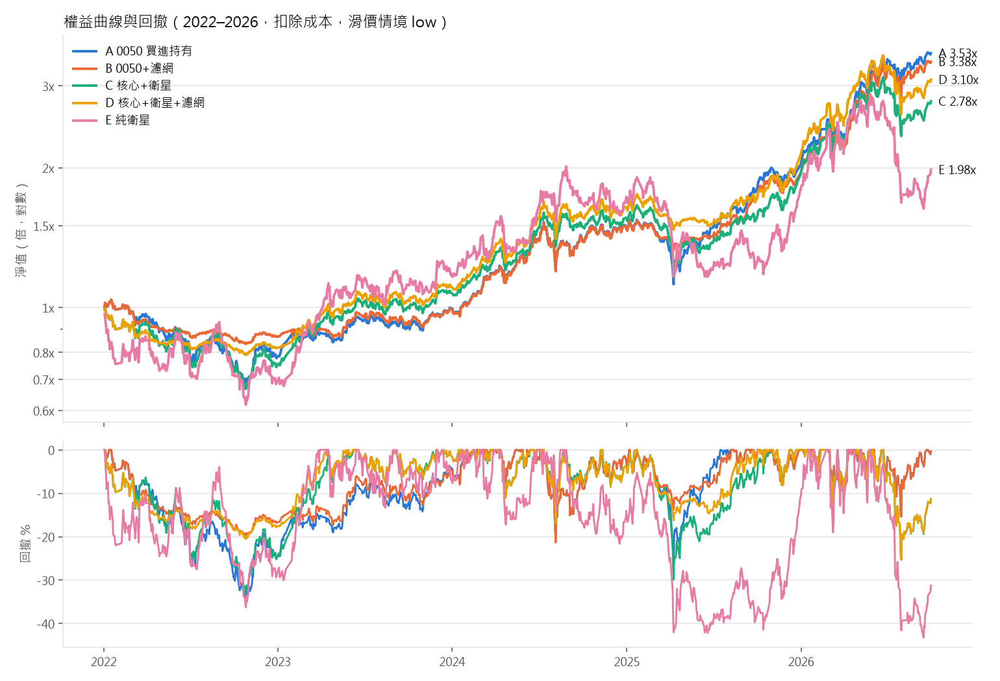
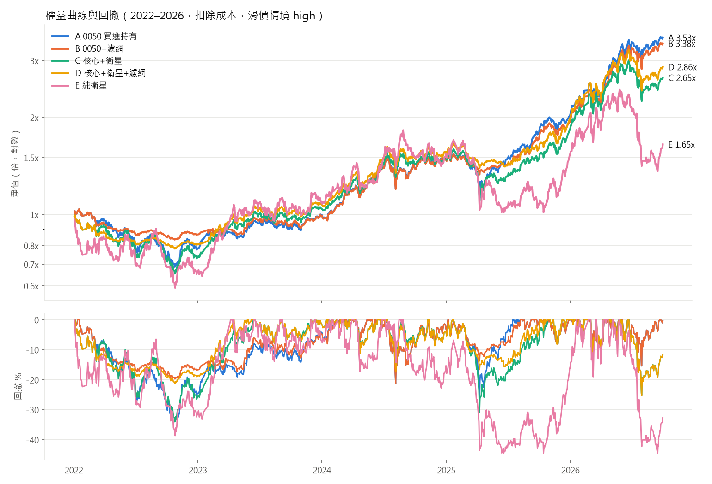

# 樣本外回測報告：2022-01-01 ~ 2026-09-30

> 資料修正：(1) 移除興櫃期間 K 線（以價格是否落在上市櫃跳動單位、且開收盤介於高低價之間偵測上市日，對證交所官方上市日期驗證 103/109 完全一致），整段期間仍為興櫃者排除；(2) 以證交所／櫃買中心官方減資與除權息紀錄補足 FinMind 缺漏的公司行為。詳見 docs/flag_review.md。策略參數未變更。

- config SHA256：`5d8cecd78487837ff5a1db92f1c2018479f5c823a0ea520e42c673ed1084cf83`（樣本外鎖定，`logs/config_lock_oos.json`；開發期 config 雜湊 ef97a2719e04…，兩者只差樣本外起訖日與解鎖開關）
- 樣本外於 2022-01-01 ~ 2026-09-30 執行；解鎖紀錄 `logs/oos_unlock_log.jsonl`；策略參數與判準與開發期相同
- 初始資金：1,000,000 元；所有數字皆已扣除手續費、證交稅與滑價

## 1. 預先宣告判準的結果

判準（跑之前已寫入 config）：mid 滑價下，扣除成本後 Sharpe(D) > Sharpe(A)，且 |MDD(D)| ≤ |MDD(A)|。

| 項目 | D | A | 是否通過 |
|---|---|---|---|
| Sharpe | 1.242 | 1.282 | ❌ |
| MDD | -25.31% | -33.91% | ✅ |

**結論：策略 D 在樣本外不成立。** 其他指標只作診斷，不影響這個判定。

## 2. 主要指標（所有組合 × 所有滑價情境）

### 滑價情境：low（普通股單邊 0.1%，ETF 0.05%）

| strategy | CAGR | MDD | Sharpe | excess_CAGR_vs_A | final_nav |
|---|---|---|---|---|---|
| A | 30.47% | -33.91% | 1.28 | 0.00% | 3,529,455 |
| B | 29.31% | -21.29% | 1.44 | -1.15% | 3,383,808 |
| C | 24.06% | -33.27% | 1.05 | -6.41% | 2,779,243 |
| D | 26.91% | -25.30% | 1.27 | -3.56% | 3,095,731 |
| E | 15.50% | -43.29% | 0.59 | -14.97% | 1,980,482 |

### 滑價情境：mid（普通股單邊 0.3%，ETF 0.05%）

| strategy | CAGR | MDD | Sharpe | excess_CAGR_vs_A | final_nav |
|---|---|---|---|---|---|
| A | 30.47% | -33.91% | 1.28 | 0.00% | 3,529,455 |
| B | 29.31% | -21.29% | 1.44 | -1.15% | 3,383,808 |
| C | 23.37% | -33.87% | 1.02 | -7.10% | 2,707,152 |
| D | 26.12% | -25.31% | 1.24 | -4.35% | 3,005,712 |
| E | 13.26% | -43.84% | 0.53 | -17.21% | 1,804,794 |

### 滑價情境：high（普通股單邊 0.5%，ETF 0.05%）

| strategy | CAGR | MDD | Sharpe | excess_CAGR_vs_A | final_nav |
|---|---|---|---|---|---|
| A | 30.47% | -33.91% | 1.28 | 0.00% | 3,529,455 |
| B | 29.31% | -21.29% | 1.44 | -1.15% | 3,383,808 |
| C | 22.83% | -34.47% | 0.99 | -7.64% | 2,651,060 |
| D | 24.84% | -25.31% | 1.19 | -5.63% | 2,863,166 |
| E | 11.10% | -44.50% | 0.48 | -19.36% | 1,647,538 |

## 3. 2×2 歸因

A = 都沒有、B = 只有濾網、C = 只有選股（衛星）、D = 兩者都有。
- 濾網貢獻 = [(B−A) + (D−C)] / 2：在「有衛星」與「沒衛星」兩種情況下，加上濾網的平均效果
- 選股貢獻 = [(C−A) + (D−B)] / 2：在「有濾網」與「沒濾網」兩種情況下，加入衛星的平均效果
- 交互作用 = (D−C) − (B−A)：濾網在有衛星時的效果，比沒衛星時多（或少）多少

**low**

| 指標 | 濾網貢獻 | 選股貢獻 | 交互作用 | D−A 合計 |
|---|---|---|---|---|
| CAGR | +0.85% | -4.41% | +4.01% | -3.56% |
| Sharpe | +0.191 | -0.199 | +0.076 | -0.007 |
| MDD | +10.29% | -1.68% | -4.65% | +8.61% |

**mid**

| 指標 | 濾網貢獻 | 選股貢獻 | 交互作用 | D−A 合計 |
|---|---|---|---|---|
| CAGR | +0.80% | -5.14% | +3.91% | -4.35% |
| Sharpe | +0.189 | -0.228 | +0.071 | -0.039 |
| MDD | +10.59% | -1.99% | -4.06% | +8.60% |

**high**

| 指標 | 濾網貢獻 | 選股貢獻 | 交互作用 | D−A 合計 |
|---|---|---|---|---|
| CAGR | +0.43% | -6.06% | +3.16% | -5.63% |
| Sharpe | +0.176 | -0.266 | +0.045 | -0.090 |
| MDD | +10.89% | -2.29% | -3.46% | +8.60% |

注意：MDD 是負數，MDD 的歸因為正代表回撤變小（改善）。濾網貢獻 + 選股貢獻 = D−A 合計；交互作用是另外的診斷量，不再加進合計。

## 4. 診斷指標（不用於判定）

| strategy | scenario | turnover | cost_total | cost_share_of_gross | avg_exposure | bull_ann_ret | bear_ann_ret | sideways_ann_ret |
|---|---|---|---|---|---|---|---|---|
| A | low | 0.09 | 2,276 | 0.09% | 99.94% | 49.19% | 11.72% | -21.66% |
| B | low | 0.76 | 24,313 | 1.01% | 82.38% | 48.67% | 3.15% | -14.12% |
| C | low | 1.95 | 99,675 | 5.30% | 89.74% | 36.87% | 6.87% | -7.66% |
| D | low | 2.32 | 119,766 | 5.41% | 76.48% | 38.00% | 2.90% | 18.98% |
| E | low | 4.73 | 238,848 | 19.59% | 85.12% | 22.97% | 0.32% | 5.14% |
| A | mid | 0.09 | 2,276 | 0.09% | 99.94% | 49.19% | 11.72% | -21.66% |
| B | mid | 0.76 | 24,313 | 1.01% | 82.38% | 48.67% | 3.15% | -14.12% |
| C | mid | 1.94 | 146,309 | 7.89% | 90.48% | 36.32% | 6.14% | -9.07% |
| D | mid | 2.32 | 169,662 | 7.80% | 76.64% | 36.94% | 2.51% | 18.54% |
| E | mid | 4.74 | 342,201 | 29.83% | 85.14% | 20.61% | -2.03% | 3.04% |
| A | high | 0.09 | 2,276 | 0.09% | 99.94% | 49.19% | 11.72% | -21.66% |
| B | high | 0.76 | 24,313 | 1.01% | 82.38% | 48.67% | 3.15% | -14.12% |
| C | high | 1.92 | 190,106 | 10.33% | 91.22% | 35.98% | 5.39% | -10.33% |
| D | high | 2.31 | 213,860 | 10.30% | 76.54% | 35.66% | 1.32% | 16.53% |
| E | high | 4.74 | 434,320 | 40.15% | 85.15% | 18.36% | -4.33% | 0.94% |

- turnover：年化換手率 =（買進＋賣出成交金額）/ 2 / 平均淨值 / 年數
- cost_share_of_gross：交易成本 /（期末淨值 − 初始資金 + 交易成本）
- 多空盤整劃分（TAIEX 收盤相對 200 日線，且 200 日線 20 日斜率同向）：多頭 801 天、空頭 232 天、盤整 116 天；每日報酬依前一日收盤的狀態歸類，數字為該狀態下的年化報酬

### 衛星交易統計（完整進出為一筆，期末未平倉以最後收盤價計）

| strategy | scenario | sat_trades | sat_avg_hold_days | win_rate | profit_factor | top5_share_of_profit | blocked_orders |
|---|---|---|---|---|---|---|---|
| C | low | 192 | 40.16 | 34.90% | 1.33 | 35.29% | 14 |
| D | low | 192 | 40.16 | 35.94% | 1.47 | 37.81% | 14 |
| E | low | 192 | 40.16 | 34.90% | 1.31 | 35.03% | 13 |
| C | mid | 192 | 40.16 | 33.85% | 1.28 | 34.97% | 14 |
| D | mid | 192 | 40.16 | 33.85% | 1.42 | 37.75% | 14 |
| E | mid | 192 | 40.16 | 33.85% | 1.26 | 34.95% | 13 |
| C | high | 192 | 40.16 | 33.85% | 1.24 | 35.35% | 13 |
| D | high | 192 | 40.16 | 33.85% | 1.36 | 37.99% | 14 |
| E | high | 192 | 40.16 | 33.85% | 1.22 | 34.92% | 13 |

- sat_avg_hold_days 以交易日計；blocked_orders = 開盤漲停買不到 + 開盤跌停賣不掉的次數

## 5. 存活者偏差的規模（決策 1a）

在 57 個月度訊號日中，平均每次有 173.6 檔股票同時符合 b（站上 60 日線）、c（RS 前 20%）、d（成交金額）。
其中「之後在樣本外內下市」者平均 1.42 檔，這些股票中缺營收資料者平均 0.00 檔；最多的一個月為 0 檔。
相對地，所有「符合 b/c/d 但缺營收」的股票（含存活股）平均 0.00 檔。
解讀：這是偏差的**上界**——即使營收資料完整，它們還要通過條件 a 並排進前 8 名才會被選入。明細在 `survivorship_bias_check.csv`。

## 6. 資料假設與限制

**資料來源與範圍**
- FinMind Free 等級；日 K 自 2014-01-01、月營收自 2012-01-01（暖機），回測期間 2022-01-01 ~ 2026-09-30；下載程式強制結束日 ≤ 2026-09-30
- 股票池：2135 檔上市櫃 4 位數普通股（含樣本外內下市者 46 檔），排除 ETF / ETN / 權證 / 特別股 / DR / 興櫃。每天只有「當天有有效 K 線」的股票可交易與排名
- 收盤價為 0 的資料列（停牌）視為無交易
- **全額交割股無法辨識，未排除**（Free 等級無資料；使用者同意）

**月營收 point-in-time**
- FinMind `date` 欄位是「營收月份 +1 個月的 1 號」，不是公告日；`create_time` 全空 → 一律以次月 11 日為可用日，遇非交易日順延
- 訊號日 = 可用日當天收盤，次一交易日開盤調倉；程式在每次執行時斷言「所有用到的營收可用日 ≤ 訊號日」（另有 pytest）
- 最新可用營收月份若落後訊號月份超過 2 個月，視為資料中斷，條件 a 不成立
- 無法得知營收是首次公告值還是更正值
- **下市股的營收大量缺漏**（抽樣 20 檔僅 4 檔完整）→ 存活者偏差，規模見第 5 節（使用者決策 1a：接受並量化）

**價格還原**
- `TaiwanStockPriceAdj` 不可用，以 DividendResult（除權息參考價）、SplitPrice / ParValueChange（分割、面額變更）自行計算還原因子；還原價只用於均線與報酬率，成交與漲跌停一律用原始價
- 共 19165 個公司行為事件
- 減資無資料：偵測到 0 個「無已知事件可解釋、且超過漲跌幅限制」的跳動，清單在 `flagged_price_jumps_for_review.csv` 待人工核對。處理方式：還原因子取 開盤/前收；持有中則以開盤價等值調整股數；之後 120 個交易日不得作為新進場標的
- 現金股利（「息」）在除息日入帳為現金；「權」「權息」因資料未拆分現金與股票部分，以參考價等值調整股數（零股部分以參考價折現）。股利所得稅、二代健保補充保費未計

**執行假設**
- 訊號日收盤產生訊號，次一交易日開盤成交；先賣後買，現金不足時等比例縮減買單
- **股數取整數股**（不限 1,000 股整張）。2020-10-26 前盤中無法零股交易，實際可行性較低；整數股假設在本資金規模下對 0050 影響小，對高價衛星股可能造成實際權重偏離
- 漲跌停：開盤 ≥ 參考價 × 上限視為買不到，≤ 參考價 × 下限視為賣不掉、延後一日；2015-06-01 前用 ±7%（1.065 / 0.935），之後 ±10%（1.095 / 0.905）（使用者決策 2）。參考價 = 前一有效收盤，除權息 / 分割日用公告參考價
- 0050 核心買不到時隔日重試；衛星新進場買不到則該格留現金至下次月調倉
- 衛星每檔固定 1/8 衛星資金，不足 8 檔的空位留現金
- 月調倉時，既有部位偏離目標權重超過 20% 才調整；濾網狀態改變時所有部位等比例縮放到新目標
- 每週最後一個交易日檢查衛星是否跌破 60 日線（月調倉日當天以月調倉規則為準）
- A、B 的 0050 現金股利於次一交易日再投入；C、D 的股利留在現金，月調倉時一併調整
- 下市股：在最後一根有效 K 線當天以收盤價（扣滑價與成本）強制出場。部分股票停止交易數月後才下市，這個假設偏樂觀（實際資金可能被卡住）
- 同產業最多 3 檔：產業為 TaiwanStockInfo 的當前分類（無歷史分類），去除「電子工業」大類並合併新舊名稱；無分類者各自視為獨立產業

**成本**
- 手續費 0.1425% × 折扣 1.0，單筆最低 20 元；賣出證交稅普通股 0.3%、ETF 0.1%
- 滑價依情境 low / mid / high = 0.1% / 0.3% / 0.5%（ETF 固定 0.05%）；依 20 日均量分級的倍數已參數化，預設全部為 1.0
- 單元測試：40 萬元普通股完整買賣一次，未計滑價成本 = 2,340 元

**指標**
- Sharpe：日報酬、無風險利率 0.0、年化 √252
- 超額報酬 = 策略 CAGR − 同情境 A 的 CAGR

## 7. 輸出檔案

- `trades_oos.csv`：每筆成交明細（所有策略 × 情境）
- `satellite_roundtrips_oos.csv`：衛星完整進出
- `metrics_oos.csv`：完整指標表
- `selection_revenue_audit.csv`：每次選股用到的營收月份與可用日（前視偏誤稽核）
- `flagged_price_jumps_for_review.csv`、`survivorship_bias_check.csv`
- `equity_drawdown_{low,mid,high}.png`
## 附錄：開發期（v2）與樣本外對照（mid 滑價）

| 策略 | CAGR 開發 | CAGR 樣本外 | MDD 開發 | MDD 樣本外 | Sharpe 開發 | Sharpe 樣本外 |
|---|---|---|---|---|---|---|
| A | 15.27% | 30.47% | -28.19% | -33.91% | 0.973 | 1.282 |
| B | 12.79% | 29.31% | -16.32% | -21.29% | 1.009 | 1.435 |
| C | 23.04% | 23.37% | -28.67% | -33.87% | 1.178 | 1.018 |
| D | 18.21% | 26.12% | -26.15% | -25.31% | 1.110 | 1.242 |
| E | 32.61% | 13.26% | -48.98% | -43.84% | 0.996 | 0.533 |
