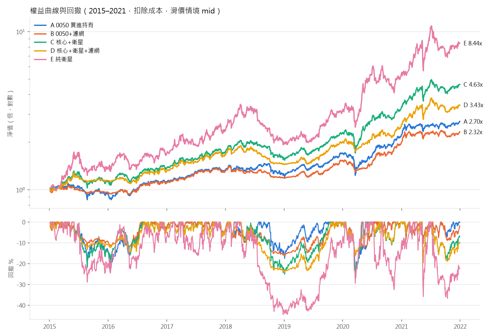
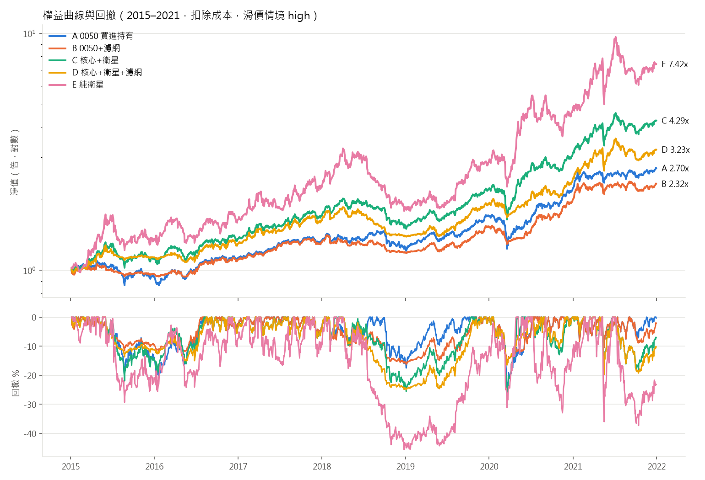

# 開發期回測報告：2015-01-01 ~ 2021-12-31

- config SHA256：`ef97a2719e045bbfa7e7528e91043bce8c130801c72c30fc45fb8e7bee91435f`（第一次執行時鎖定，存於 `logs/config_lock.json`）
- 樣本外（2022-01-01 起）：鎖定，未執行、未查看
- 初始資金：1,000,000 元；所有數字皆已扣除手續費、證交稅與滑價

## 1. 預先宣告判準的結果

判準（跑之前已寫入 config）：mid 滑價下，扣除成本後 Sharpe(D) > Sharpe(A)，且 |MDD(D)| ≤ |MDD(A)|。

| 項目 | D | A | 是否通過 |
|---|---|---|---|
| Sharpe | 1.175 | 0.973 | ✅ |
| MDD | -24.00% | -28.19% | ✅ |

**結論：策略 D 在開發期成立。** 其他指標只作診斷，不影響這個判定。

## 2. 主要指標（所有組合 × 所有滑價情境）

### 滑價情境：low（普通股單邊 0.1%，ETF 0.05%）

| strategy | CAGR | MDD | Sharpe | excess_CAGR_vs_A | final_nav |
|---|---|---|---|---|---|
| A | 15.27% | -28.19% | 0.97 | 0.00% | 2,699,344 |
| B | 12.79% | -16.32% | 1.01 | -2.48% | 2,318,635 |
| C | 25.21% | -27.53% | 1.28 | 9.93% | 4,809,456 |
| D | 20.33% | -23.00% | 1.23 | 5.06% | 3,644,387 |
| E | 38.16% | -43.54% | 1.12 | 22.89% | 9,569,687 |

### 滑價情境：mid（普通股單邊 0.3%，ETF 0.05%）

| strategy | CAGR | MDD | Sharpe | excess_CAGR_vs_A | final_nav |
|---|---|---|---|---|---|
| A | 15.27% | -28.19% | 0.97 | 0.00% | 2,699,344 |
| B | 12.79% | -16.32% | 1.01 | -2.48% | 2,318,635 |
| C | 24.53% | -28.53% | 1.25 | 9.26% | 4,631,778 |
| D | 19.31% | -24.00% | 1.18 | 4.04% | 3,434,216 |
| E | 35.70% | -44.55% | 1.07 | 20.43% | 8,441,065 |

### 滑價情境：high（普通股單邊 0.5%，ETF 0.05%）

| strategy | CAGR | MDD | Sharpe | excess_CAGR_vs_A | final_nav |
|---|---|---|---|---|---|
| A | 15.27% | -28.19% | 0.97 | 0.00% | 2,699,344 |
| B | 12.79% | -16.32% | 1.01 | -2.48% | 2,318,635 |
| C | 23.15% | -28.77% | 1.19 | 7.88% | 4,285,060 |
| D | 18.28% | -25.01% | 1.12 | 3.01% | 3,231,300 |
| E | 33.21% | -45.56% | 1.02 | 17.94% | 7,415,294 |

## 3. 2×2 歸因

A = 都沒有、B = 只有濾網、C = 只有選股（衛星）、D = 兩者都有。
- 濾網貢獻 = [(B−A) + (D−C)] / 2：在「有衛星」與「沒衛星」兩種情況下，加上濾網的平均效果
- 選股貢獻 = [(C−A) + (D−B)] / 2：在「有濾網」與「沒濾網」兩種情況下，加入衛星的平均效果
- 交互作用 = (D−C) − (B−A)：濾網在有衛星時的效果，比沒衛星時多（或少）多少

**low**

| 指標 | 濾網貢獻 | 選股貢獻 | 交互作用 | D−A 合計 |
|---|---|---|---|---|
| CAGR | -3.68% | +8.74% | -2.39% | +5.06% |
| Sharpe | -0.008 | +0.264 | -0.089 | +0.256 |
| MDD | +8.20% | -3.01% | -7.34% | +5.19% |

**mid**

| 指標 | 濾網貢獻 | 選股貢獻 | 交互作用 | D−A 合計 |
|---|---|---|---|---|
| CAGR | -3.85% | +7.89% | -2.74% | +4.04% |
| Sharpe | -0.020 | +0.223 | -0.113 | +0.203 |
| MDD | +8.20% | -4.01% | -7.34% | +4.19% |

**high**

| 指標 | 濾網貢獻 | 選股貢獻 | 交互作用 | D−A 合計 |
|---|---|---|---|---|
| CAGR | -3.68% | +6.68% | -2.39% | +3.01% |
| Sharpe | -0.017 | +0.165 | -0.106 | +0.148 |
| MDD | +7.82% | -4.63% | -8.11% | +3.18% |

注意：MDD 是負數，MDD 的歸因為正代表回撤變小（改善）。濾網貢獻 + 選股貢獻 = D−A 合計；交互作用是另外的診斷量，不再加進合計。

## 4. 診斷指標（不用於判定）

| strategy | scenario | turnover | cost_total | cost_share_of_gross | avg_exposure | bull_ann_ret | bear_ann_ret | sideways_ann_ret |
|---|---|---|---|---|---|---|---|---|
| A | low | 0.06 | 2,528 | 0.15% | 99.94% | 18.61% | 11.86% | 6.51% |
| B | low | 2.20 | 102,446 | 7.21% | 83.37% | 17.64% | 3.30% | 4.98% |
| C | low | 1.87 | 216,234 | 5.37% | 92.09% | 29.23% | 26.41% | 9.33% |
| D | low | 3.39 | 295,947 | 10.07% | 77.66% | 27.59% | 8.31% | 6.58% |
| E | low | 4.57 | 863,661 | 9.16% | 86.42% | 43.43% | 46.65% | 10.97% |
| A | mid | 0.06 | 2,528 | 0.15% | 99.94% | 18.61% | 11.86% | 6.51% |
| B | mid | 2.20 | 102,446 | 7.21% | 83.37% | 17.64% | 3.30% | 4.98% |
| C | mid | 1.84 | 312,717 | 7.93% | 92.50% | 28.26% | 27.92% | 7.11% |
| D | mid | 3.39 | 391,329 | 13.85% | 77.79% | 26.55% | 7.87% | 4.63% |
| E | mid | 4.58 | 1,200,323 | 13.89% | 86.44% | 41.15% | 43.59% | 7.91% |
| A | high | 0.06 | 2,528 | 0.15% | 99.94% | 18.61% | 11.86% | 6.51% |
| B | high | 2.20 | 102,446 | 7.21% | 83.37% | 17.64% | 3.30% | 4.98% |
| C | high | 1.86 | 404,205 | 10.96% | 92.48% | 26.55% | 27.13% | 6.22% |
| D | high | 3.40 | 479,366 | 17.68% | 77.91% | 25.46% | 7.45% | 2.75% |
| E | high | 4.57 | 1,473,833 | 18.68% | 86.46% | 38.77% | 40.66% | 4.95% |

- turnover：年化換手率 =（買進＋賣出成交金額）/ 2 / 平均淨值 / 年數
- cost_share_of_gross：交易成本 /（期末淨值 − 初始資金 + 交易成本）
- 多空盤整劃分（TAIEX 收盤相對 200 日線，且 200 日線 20 日斜率同向）：多頭 1176 天、空頭 320 天、盤整 216 天；每日報酬依前一日收盤的狀態歸類，數字為該狀態下的年化報酬

### 衛星交易統計（完整進出為一筆，期末未平倉以最後收盤價計）

| strategy | scenario | sat_trades | sat_avg_hold_days | win_rate | profit_factor | top5_share_of_profit | blocked_orders |
|---|---|---|---|---|---|---|---|
| C | low | 265 | 44.26 | 40.38% | 2.05 | 27.90% | 10 |
| D | low | 265 | 44.26 | 40.75% | 1.88 | 28.03% | 11 |
| E | low | 265 | 44.26 | 40.00% | 1.93 | 31.11% | 11 |
| C | mid | 265 | 44.26 | 39.25% | 1.97 | 28.41% | 10 |
| D | mid | 265 | 44.26 | 39.62% | 1.79 | 28.03% | 11 |
| E | mid | 265 | 44.26 | 38.87% | 1.86 | 30.60% | 11 |
| C | high | 265 | 44.26 | 38.11% | 1.88 | 28.12% | 10 |
| D | high | 265 | 44.26 | 38.49% | 1.71 | 28.00% | 11 |
| E | high | 265 | 44.26 | 37.74% | 1.79 | 30.10% | 11 |

- sat_avg_hold_days 以交易日計；blocked_orders = 開盤漲停買不到 + 開盤跌停賣不掉的次數

## 5. 存活者偏差的規模（決策 1a）

在 84 個月度訊號日中，平均每次有 123.5 檔股票同時符合 b（站上 60 日線）、c（RS 前 20%）、d（成交金額）。
其中「之後在開發期內下市」者平均 3.45 檔，這些股票中缺營收資料者平均 2.35 檔；最多的一個月為 11 檔。
相對地，所有「符合 b/c/d 但缺營收」的股票（含存活股）平均 2.64 檔。
解讀：這是偏差的**上界**——即使營收資料完整，它們還要通過條件 a 並排進前 8 名才會被選入。明細在 `survivorship_bias_check.csv`。

## 6. 資料假設與限制

**資料來源與範圍**
- FinMind Free 等級；日 K 自 2014-01-01、月營收自 2012-01-01（暖機），回測期間 2015-01-01 ~ 2021-12-31；下載程式強制結束日 ≤ 2021-12-31
- 股票池：1961 檔上市櫃 4 位數普通股（含開發期內下市者 108 檔），排除 ETF / ETN / 權證 / 特別股 / DR / 興櫃。每天只有「當天有有效 K 線」的股票可交易與排名
- 收盤價為 0 的資料列（停牌）視為無交易
- **全額交割股無法辨識，未排除**（Free 等級無資料；使用者同意）

**月營收 point-in-time**
- FinMind `date` 欄位是「營收月份 +1 個月的 1 號」，不是公告日；`create_time` 全空 → 一律以次月 11 日為可用日，遇非交易日順延
- 訊號日 = 可用日當天收盤，次一交易日開盤調倉；程式在每次執行時斷言「所有用到的營收可用日 ≤ 訊號日」（另有 pytest）
- 最新可用營收月份若落後訊號月份超過 2 個月，視為資料中斷，條件 a 不成立
- 無法得知營收是首次公告值還是更正值
- **下市股的營收大量缺漏**（抽樣 20 檔僅 4 檔完整）→ 存活者偏差，規模見第 5 節（使用者決策 1a：接受並量化）

**價格還原**
- `TaiwanStockPriceAdj` 不可用，以 DividendResult（除權息參考價）、SplitPrice / ParValueChange（分割、面額變更）自行計算還原因子；還原價只用於均線與報酬率，成交與漲跌停一律用原始價
- 共 10376 個公司行為事件
- 減資無資料：偵測到 982 個「無已知事件可解釋、且超過漲跌幅限制」的跳動，清單在 `flagged_price_jumps_for_review.csv` 待人工核對。處理方式：還原因子取 開盤/前收；持有中則以開盤價等值調整股數；之後 120 個交易日不得作為新進場標的
- 現金股利（「息」）在除息日入帳為現金；「權」「權息」因資料未拆分現金與股票部分，以參考價等值調整股數（零股部分以參考價折現）。股利所得稅、二代健保補充保費未計

**執行假設**
- 訊號日收盤產生訊號，次一交易日開盤成交；先賣後買，現金不足時等比例縮減買單
- **股數取整數股**（不限 1,000 股整張）。2020-10-26 前盤中無法零股交易，實際可行性較低；整數股假設在本資金規模下對 0050 影響小，對高價衛星股可能造成實際權重偏離
- 漲跌停：開盤 ≥ 參考價 × 上限視為買不到，≤ 參考價 × 下限視為賣不掉、延後一日；2015-06-01 前用 ±7%（1.065 / 0.935），之後 ±10%（1.095 / 0.905）（使用者決策 2）。參考價 = 前一有效收盤，除權息 / 分割日用公告參考價
- 0050 核心買不到時隔日重試；衛星新進場買不到則該格留現金至下次月調倉
- 衛星每檔固定 1/8 衛星資金，不足 8 檔的空位留現金
- 月調倉時，既有部位偏離目標權重超過 20% 才調整；濾網狀態改變時所有部位等比例縮放到新目標
- 每週最後一個交易日檢查衛星是否跌破 60 日線（月調倉日當天以月調倉規則為準）
- A、B 的 0050 現金股利於次一交易日再投入；C、D 的股利留在現金，月調倉時一併調整
- 下市股：在最後一根有效 K 線當天以收盤價（扣滑價與成本）強制出場。部分股票停止交易數月後才下市，這個假設偏樂觀（實際資金可能被卡住）
- 同產業最多 3 檔：產業為 TaiwanStockInfo 的當前分類（無歷史分類），去除「電子工業」大類並合併新舊名稱；無分類者各自視為獨立產業

**成本**
- 手續費 0.1425% × 折扣 1.0，單筆最低 20 元；賣出證交稅普通股 0.3%、ETF 0.1%
- 滑價依情境 low / mid / high = 0.1% / 0.3% / 0.5%（ETF 固定 0.05%）；依 20 日均量分級的倍數已參數化，預設全部為 1.0
- 單元測試：40 萬元普通股完整買賣一次，未計滑價成本 = 2,340 元

**指標**
- Sharpe：日報酬、無風險利率 0.0、年化 √252
- 超額報酬 = 策略 CAGR − 同情境 A 的 CAGR

## 7. 輸出檔案

- `trades_dev_2015_2021.csv`：每筆成交明細（所有策略 × 情境）
- `satellite_roundtrips_dev_2015_2021.csv`：衛星完整進出
- `metrics_dev_2015_2021.csv`：完整指標表
- `selection_revenue_audit.csv`：每次選股用到的營收月份與可用日（前視偏誤稽核）
- `flagged_price_jumps_for_review.csv`、`survivorship_bias_check.csv`
- `equity_drawdown_{low,mid,high}.png`